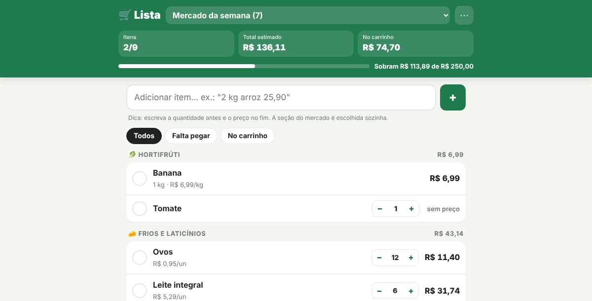

# ShoppingList — Lista de compras

Lista de compras organizada pelas seções do mercado, com quantidades, preços, total estimado e orçamento.

🔗 **[Ver o site no ar](https://iamviniciuslima05.github.io/PROJETO-ShoppingList/)**



## Funcionalidades

- Escreva **"2 kg arroz 25,90"** e a quantidade, a unidade e o preço são entendidos sozinhos
- Itens separados por **seção do mercado** automaticamente
- **Total estimado**, valor no carrinho e **orçamento** com barra
- Marcar itens pegos com um toque e filtro **falta pegar**
- **Várias listas**, duplicar e desmarcar tudo
- **Enviar pelo WhatsApp** ou copiar a lista
- Sugestões com os itens que você já usou e **desfazer** exclusões

## Tecnologias

HTML5 · CSS3 · JavaScript · localStorage

## Estrutura

```
index.html
css/style.css
js/script.js
```

## Como rodar

Não precisa instalar nada: baixe o projeto e abra o `index.html` no navegador, ou acesse a versão publicada acima.

---
Feito por **Vinicius Lima** · [Portfólio](https://viniciuslimadev.netlify.app) · [LinkedIn](https://www.linkedin.com/in/viniciuslima25/)
